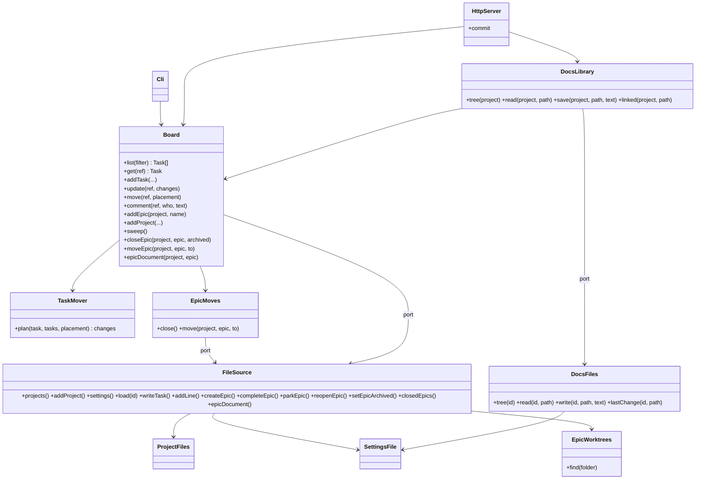

# Architecture

Doit is built from modules wired in one composition root. The general rules are in `Docs/Standard/Core/03-Design.md`; this file holds this project's instance of them.

## Layers

| Tier | Modules | May reference | Never references |
|---|---|---|---|
| Domain | `src/domain/` | itself only | `node:fs`, `node:http`, the store, the CLI, the server |
| Adapters | `src/store/` | the domain, `node:fs`, `node:path`, `node:os`, `node:child_process` (git, for who last changed a document) | the CLI, the server |
| Interface | `src/cli/`, `src/server/`, `web/` | the domain (the `Board` and `DocsLibrary` facades and their value types) | the store, each other; `web/` only talks HTTP |
| Composition root | `src/root.js`, `bin/` | everything | |

Module order, low to high: domain → store → cli, server → root.

## How the boundaries are enforced

`test/boundaries.test.js` reads every `import` in `src/` and `bin/` and fails when a module imports a tier it may not, per the table above.

## Modules

- `domain/task.js`: the task value, its states, sections and defaults for a task without a file. Pure.
- `domain/rules.js`: the sweep (deadline and retention archiving), whether a closed epic is archived (`epicArchived`) and rank between neighbours (the only place ranks are computed; the page asks `Board.move`). Pure, takes today's date.
- `domain/mover.js`: `TaskMover`, where a task goes in the Open tab: from the task and its project's tasks it returns the rank and state change. Pure; `Board.move` delegates to it.
- `domain/epicMoves.js`: `EpicMoves`, closes an epic and moves it between open, parked, completed and archived; `planEpicMove` is pure (epic and tasks in, plan out, or a refusal). `Board.closeEpic` and `Board.moveEpic` delegate to it. A reopen restores the tasks archived with reason `Epic <id> closed`.
- `domain/board.js`: `Board`, the facade both interfaces use. Lists, filters, creates, updates, moves (via `TaskMover`), comments, sweeps, closes an epic (archives its tasks, then the source sets it Done, writes `Closed: <date>` and files it in `Completed/`), returns the closed epics in `view` as `closedEpics` (each with `closed` and `archived`, an `Archived:` line counting) and parked ones as `parkedEpics`, next to the open `epics` (the CLI's `epics` lists open then parked) and serves an epic's document. Given a `ProjectSource` (the store's port: `projects()`, `load(project)`, `save...`) and a clock.
- `store/markdown.js`: parses and writes epic files and task files. Pure text in and out.
- `store/projectFiles.js`: `ProjectFiles`, reads and writes one project's docs folder: epics, task files, archive moves, new epic, move to Completed, project scaffold.
- `store/settings.js`: `SettingsFile`, the project list and settings in the app's data folder.
- `store/worktrees.js`: `EpicWorktrees`, finds the worktrees on `epic/<nnn>-…` branches by reading `.git/worktrees`, no git process.
- `store/source.js`: `FileSource`, the port implementation the board is given; joins the settings file and each project's files, and reads and writes an epic's file and task files in its worktree when `EpicWorktrees` finds one.
- `domain/docs.js`: `DocsLibrary`, the docs facade: tree, read, save and the tasks linked to a document, over a `DocsSource` port and the `Board`; `checkDocPath` keeps paths inside the docs folder (`.md` only, no `..`, no hidden names). Pure.
- `store/docsFolder.js`: `DocsFiles`, the `DocsSource` port on disk: the docs tree (leaving out `Archive/`, `Epics/Tasks/`, `Standard/`, folding `Epics/Completed/`), read, write, and the last change from `git log`.
- `cli/cli.js`: `Cli`, parses arguments and prints. Given a `Board` and an output stream.
- `server/server.js`: `HttpServer`, the JSON API (including `GET /api/version`, the start commit) and the static page. Given a `Board`, the web folder, the commit and the `DocsLibrary` (the `/api/docs/` routes); `bin/server.js` reads the commit with `git rev-parse HEAD`.
- `launcher/`: `Doit.applescript` (the app), `start-server.sh`, `check-server.sh` (running server on the checked-out commit? exit 0, 1 none, 3 other) and `stop-server.sh`.
- `web/`: the board page, plain HTML, CSS and JS as ES modules, none over 300 lines: `state.js` (page state, helpers, API calls), `render.js` (views), `epicView.js` (the epic document view and its Close epic button), `epicList.js` (the left pane's epic buttons and the Closed and Archived sections), `docsView.js` (the Docs view: tree, document, linked tasks), `markdown.js` (markdown to HTML, no packages), `ordering.js` (drag and keyboard moves), `resize.js` (column widths), `events.js` (listeners and the reload), `app.js` (wires them).
- `root.js`: builds the settings file, the worktree finder, the source, the board, the docs files and library, and hands the board to the CLI or the server.

## Class diagram

## Departures

| Where | What | Why | Until |
|---|---|---|---|
| `Board.view`, `Board.list` | A read sweeps first: it archives tasks past their deadline or retention, which writes files | Archiving is by date and nothing else runs on a schedule; without it a read would show tasks that should be gone | EPIC-004's morning run sweeps on a schedule, if reads are then fast enough without it |

## Design hooks

| Hook | Why the later iteration needs it |
|---|---|
| Task `source` field (where a task came from) | The Marketing epic marks fetched events and Reddit threads |
| Board API is read from disk on every request | The morning run writes through the CLI while the page is open |
