# Architecture

Doit is built from modules wired in one composition root. The general rules are in `Docs/Standard/Core/03-Design.md`; this file holds this project's instance of them.

## Layers

| Tier | Modules | May reference | Never references |
|---|---|---|---|
| Domain | `src/domain/` | itself only | `node:fs`, `node:http`, the store, the CLI, the server |
| Adapters | `src/store/` | the domain, `node:fs`, `node:path`, `node:os`, `node:child_process` (git, for who last changed a document; `security`, to read the mail password from the Keychain), `node:tls` (only here: SMTP and IMAP), `node:sqlite` (only here: `marketing.db`) | the CLI, the server |
| Interface | `src/cli/`, `src/server/`, `web/` | the domain (the `Board`, `DocsLibrary`, `ClaudeView`, `ContactBook`, `Mailroom` and `Outreach` facades and their value types) | the store, each other; `web/` only talks HTTP |
| Composition root | `src/root.js`, `bin/` | everything | |

Module order, low to high: domain → store → cli, server → root.

## How the boundaries are enforced

`test/boundaries.test.js` reads every `import` in `src/` and `bin/` and fails when a module imports a tier it may not, per the table above.

## Modules

- `domain/task.js`: the task value, its states, sections and defaults for a task without a file; it carries `agent`, `model` and `effort` (free text, free text, one of `EFFORTS`; null when unset, kept in the task file, never touched by a change of owner) and `contact` (a contact id or null, kept in the task file like `blocks`) and `game` (the campaign epic's game or null). Pure.
- `domain/campaignBrief.js`: `BRIEF_KEYS`, `OCCASIONS` and `checkBrief(changes, current)`: lower-case brief keys, occasion one of release, demo, festival, update, sale, announcement, other, starts/ends as dates with ends not before starts, the rest one line; an empty value clears. Pure.
- `domain/rules.js`: the sweep (deadline and retention archiving), whether a closed epic is archived (`epicArchived`) and rank between neighbours (the only place ranks are computed; the page asks `Board.move`). Pure, takes today's date.
- `domain/mover.js`: `TaskMover`, where a task goes in the Open tab: from the task and its project's tasks it returns the rank and state change. Pure; `Board.move` delegates to it.
- `domain/activity.js`: `ActivityLog`, the activity log: one line per task change (`YYYY-MM-DD HH:MM  <project/T-id>  <what>`), newest first for reading, lines past 30 days dropped on write; `describeChanges` puts a task update in words. Over an activity-file port. Pure.
- `domain/epicMoves.js`: `EpicMoves`, closes an epic and moves it between open, parked, completed and archived; `planEpicMove` is pure (epic and tasks in, plan out, or a refusal). `Board.closeEpic` and `Board.moveEpic` delegate to it. `close` throws, before archiving anything, while the task the epic's `check` names is neither done nor archived, so the CLI, the button and the drags are all held. A reopen restores the tasks archived with reason `Epic <id> closed`.
- `domain/board.js`: `Board`, the facade both interfaces use. Lists, filters, creates, updates, moves (via `TaskMover`), comments, sweeps, closes an epic (archives its tasks, then the source sets it Done, writes `Closed: <date>` and files it in `Completed/`), returns the closed epics in `view` as `closedEpics` (each with `closed` and `archived`, an `Archived:` line counting) and parked ones as `parkedEpics`, next to the open `epics` (the CLI's `epics` lists open then parked) and serves an epic's document. An epic carries `game`, `event` (the `Game:` and `Event:` lines of a campaign, null when absent) `brief` (the brief lines, `""` for each absent one) and `after` (the epic its `Order: after EPIC-<nnn>` line names, null without one; also on parked epics); `setEpicHeader(project, epicId, key, value)` writes or removes one header line through the source and records it; `addTask` and `update` accept `contact` (a whole-number id or empty), and `subscribe(listener)` hands each listener a plain fact `{ref, project, epic, title, contact, game, date}` when a task with a contact moves to done. Given a `ProjectSource` (the store's port: `projects()`, `load(project)`, `save...`) a clock and a `record(ref, what)` function from the root that it tells every change it writes (the root points it at the `ActivityLog`, so the CLI and the page are logged alike).
- `domain/taskEdit.js`: `applyChanges(task, changes, now)`, the field edits of `Board.update` (state, owner, type, deadline, rank, blocks, contact, agent, model, effort, title, doneWhen, description) with their checks. Pure; split out so `board.js` stays under 220 lines.
- `domain/taskLoader.js`: `loadTasks(source, project, archived)`, joins epics, checklist lines and task files into tasks (the Board's read side, split out to keep `board.js` under 220 lines). Pure over the source port.
- `domain/doneNotifier.js`: `DoneNotifier`, `subscribe(listener)` and `announce(task, now)`, which hands each listener the plain done fact for a task with a contact; a listener's failure goes to `onError(fact, error)` (the Board points it at `record`, so it reaches the activity log). `Board.subscribe` delegates to it.
- `store/markdown.js`: parses and writes epic files and task files, including the `Game:` and `Event:` lines under `Status:` and the campaign brief lines (`BRIEF_KEYS`: Occasion, Goal, Change, Measure, Audience, Message, Ask, Channels, Starts, Ends, Budget; a `<...>` Goal is a placeholder, read as empty; `setHeader(text, key, value)` adds, replaces or removes one header line in a fixed order) `parseEpic` reads `check`, the task id in the Test plan's `- Check in play: T-<nnn>.<n>` line (null without one), and `after`, the first `EPIC-<nnn>` following "after" in the header's `Order:` line (null without one), and the task's `contact` field. Pure text in and out.
- `store/projectFiles.js`: `ProjectFiles`, reads and writes one project's docs folder: epics, task files, archive moves, new epic, move to Completed, project scaffold.
- `store/activityFile.js`: `ActivityFile`, `activity.log` in the app's data folder: read its lines, append, or replace them all.
- `store/settings.js`: `SettingsFile`, the project list and settings in the app's data folder.
- `store/worktrees.js`: `EpicWorktrees`, finds the worktrees on `epic/<nnn>-…` branches by reading `.git/worktrees`, no git process.
- `store/changeWatcher.js`: `ChangeWatcher`, watches the data folder, each project's docs folder and each epic worktree's docs folder with `fs.watch`, debounces bursts (300 ms) into one call to its subscribers and rebuilds its folder list when the settings file changes and every 5 s (a new worktree makes no event in a watched folder). Over `SettingsFile` and `EpicWorktrees`; only the root builds it.
- `store/source.js`: `FileSource`, the port implementation the board is given; joins the settings file and each project's files, and reads and writes an epic's file and task files in its worktree when `EpicWorktrees` finds one.
- `domain/claude.js`: `ClaudeView`, the Claude view's facade: from the board's tasks and the activity log, the panes Working on now, Blocked on you (human To-do tasks with `blocks`), Due within 7 days (what the badge counts) and Up next, each card with its last logged change; `morning()` sweeps and writes the morning report (`morningReport`, pure) to the log as one block; `note(topic, text)` writes one line under a name that is not a task (`doit log`, used by the festivals run). The pane filters (`workingOn`, `blockedOnYou`, `upNext`, `dueSoon`) are pure functions. Given the `Board` and the `ActivityLog`.
- `domain/docs.js`: `DocsLibrary`, the docs facade: tree, read, save and the tasks linked to a document, over a `DocsSource` port and the `Board`; `checkDocPath` keeps paths inside the docs folder (`.md` only, no `..`, no hidden names). Pure.
- `store/docsFolder.js`: `DocsFiles`, the `DocsSource` port on disk: the docs tree (leaving out `Archive/`, `Epics/Tasks/`, `Standard/`, folding `Epics/Completed/`), read, write, and the last change from `git log`.
- `domain/contacts.js`: the `Contact` value and its vocabulary (types, statuses, channel kinds, touch kinds), validation that refuses an unknown value (reach is a non-negative whole follower count or empty; genres are a list of tags; about is free text), and the filters (`contactFilter`: type, game fit, contacted about a game, not contacted about a game, no about text, genre, status, reach at least n followers, due by date). `lastContact(touches)` is the newest touch date, `historyOf(touches, sentDrafts)` a contact's touches and sent drafts newest first (a draft its send logged as a touch shows once); `genresOf(contacts)` the genres in use. Pure.
- `domain/contactBook.js`: `ContactBook`, the contacts facade: list with filters, get (each contact carries `due`, `last`, the date of its newest touch, and `active`, the newest reply or video touch), `genres()`, add, update, set and remove fit, add touch, the profiles, and the sheet import (`importCsv(text)`, so an interface never calls the mapper). Over a `ContactSource` port (`all()`, `get(id)`, `insert(contact)`, `update(id, contact)`, `setFit(id, game, reason)`, `removeFit(id, game)`, `addTouch(id, touch)`, a touch with optional `note` and `ref`) and a `ProfileShelf` port (`list()`, `has(game)`, `create`, `createFor`, `save(project, fields)`), with a clock for "due". A fit to a game with no profile is refused. Festivals: `festivals(filter)` (by deadline with days left, optionally only those matching a game through `EventMatch`), `upsertFestival` (by name and year, only the given fields change), `setFestivalState`.
- `domain/events.js`: the event fields of a festival or conference contact, pure: `checkEvent` (year; start, end and application deadline as dates; cost as text; where: steam, epic, gog, itch, physical, online; criteria `{genres, stages, platforms}`, stages being game stages; watch state: watching, applied, accepted, declined, past) refuses an unknown value, `daysLeft`. A contact carries `event` (null when it is not an event); only types festival and conference may.
- `domain/eventMatch.js`: `EventMatch.check(profile, festival)`, pure: `{match:true}`, `{match:true, criteriaUnknown:true}` (no criteria at all) or `{match:false, reason}`. Each criterion that is given must hold: a genre in common, the game's stage among the allowed stages, a platform in common; a criterion left empty is not checked. Tests: `test/eventMatch.test.js` ("matches on a genre in common", "refuses on a genre not shared", "refuses on stage", "refuses on platform", "marks a festival without criteria as unknown", "checks only the criteria given", "refuses a contact that is not an event"); fields in `test/events.test.js`.
- `domain/contactImport.js`: the sheet import, pure: `parseCsv` (quotes, commas and newlines in quoted fields), `mapStreamers` (every column of the New Streamers sheet: `Contact` is the email; Linktree, Youtube, Twitch, Steam, Discord, Bluesky, X, Instagram, Facebook and WWW are channels of that kind, a bare `@handle` becoming a profile link; a reach bucket such as `D - Big >5.000` is its lower bound, a count is kept, any other text is left out of reach and noted as `Sheet reach: <cell>`; `dateOf` reads `16-Sep-2025`; Genre to genres; Last Contact to a dated mail touch, Replied and Posted Video to touches, BB1 and BB2 to mail touches for `bunny-bunker` noted `BB1`/`BB2`, dated by Last Contact or, with none, the import day), `mergeNotes` (a re-import keeps what a person wrote and replaces the import's own `Sheet reach`/`Platform` lines) and `takeGenreLines` (the schema migration moves an old `Genre:` line out of notes). `ContactBook.import(rows)` matches by email, then a channel of one person (not Discord or a website), then name where emails do not clash, and returns `{added, updated, skipped}`; the sheet's touches are logged once (a reply, video or a game's mailing by kind, game and note; a mail by date).
- `store/sqliteContacts.js`: `SqliteContacts`, the `ContactSource` port on `marketing.db` in the data folder (`node:sqlite`): tables contacts (with genres, about and special), channels, fit, touches, events (a festival's event, one row per contact); the handle and the schema (`PRAGMA user_version` 4) come from `MarketingDb`, opened on first use, so a command that never reads contacts leaves no file. A touch carries a note and a ref (a ref is logged once).
- `store/profileShelf.js`: `ProfileShelf`, the profile port (a project marked `marketed: false` in the settings file is left out): reads each registered project's `<docs folder>/Marketing/Profile.md` (the game is the project id) and `<docs folder>/Profiles/*.md` of the marketing project (settings key `marketingProject`, default `polyspice-marketing`, resolved through `SettingsFile`) for games without a project; a project's own wins and takes the project's kind, and a project with a kind but no file is listed with `missing`. Writes a template with `createFor(project, kind)` or `create(game, name)`; `save(project, fields)` sets Kind, Genres, Platforms, Stage, Release and Needs in a project's Profile.md (created from the template when missing, every other line kept) and refuses a project with no kind.
- `domain/mail.js`: the mail vocabulary, pure: `parseTemplate`, `fillTemplate` (refuses a `{{...}}` left over with a `MailError`), the draft value and its states (draft, approved, sent, failed) with edit and approve rules, and `composeMail` (headers, RFC 2047 subject, base64 body, Message-ID).
- `domain/mail.js` also decodes headers read from IMAP (`decodeHeader`, `parseMessageHeaders`: encoded words, From address, date, Message-ID).
- `domain/mailroom.js`: `Mailroom`, the mail facade: templates, draft, edit, discard, approve and send (daily cap, touch, copy to Marketing), `sweep` (replies in Inbox logged as touches and moved to Marketing), `status`, `history(contact)` (touches and sent drafts through `historyOf`). Over ports for drafts, the `ContactBook`, templates, account, sender and mailbox. The root builds one `MarketingDb` per process (`makeMarketing`) and gives it to the contacts and the drafts store.
- `store/marketingDb.js`: `MarketingDb`, the handle on `marketing.db` shared by `SqliteContacts` and `SqliteDrafts`: opens on first use, migrations (`user_version` 5: special on contacts; 4: genres and about on contacts, and a `Genre:` line moved out of notes), `atomic(fn)`, `close()`.
- `store/sqliteDrafts.js`: `SqliteDrafts`, the drafts port on `marketing.db`: `all(filter)`, `get`, `insert`, `update`, `remove`, `sentOn(day)`.
- `store/templateShelf.js`: `TemplateShelf`, reads `<docs folder>/Templates/*.md` of the marketing project: `list()`, `read(name)`.
- `store/mailAccount.js`: `MailAccount`, the account from settings key `mail` and the app password from the Keychain (`security find-generic-password -s doit-mail -a <address> -w` through `execFile`); `read()` gives the account or `null`. The password is never stored or logged.
- `store/smtpSender.js`: `SmtpSender`, a minimal SMTP client over `node:tls` (port 465, AUTH PLAIN); `send(account, message)` returns `{ok}` or `{ok: false, error}`, never throws.
- `store/imapMailbox.js`: `ImapMailbox`, a minimal IMAP client over `node:tls`: `session(account, fn)` with select, search from, headers (never bodies), move, sent mailbox, copy by Message-ID. Errors come back as results.
- `cli/mailCli.js`: `MailCli`, the mail commands (`templates`, `draft`, `drafts`, `mail sweep`), over the `Mailroom`. Nothing approves or sends. `Cli.run` returns a promise of the exit code when a command is async (`mail sweep`); `bin/doit.js` awaits it.
- `server/mailRoutes.js`: `mailRoutes(mailroom)`, the `/api/drafts` (list, show, edit, discard, send) and `/api/mail` (sweep, status) routes, and `GET /api/contacts/:id/history`; refusals are 400, a missing draft 404. `HttpServer` awaits async handlers and takes the `Mailroom` as its last argument.
- `web/draftsPane.js`: the Drafts pane of the Marketing view (each draft as the mail will look, edit, approve and send, discard, status line); pure HTML and request builders like `contactDetail.js`. `marketingView.js` switches between the Contacts and Drafts panes and sweeps once when the view opens.
- `domain/outreachPlan.js`: the weekly outreach list, pure. `planWeek({contacts, festivals, tasks, today, caps, window})` gives `{contacts, festivals, steps}` (contacts: open campaign tasks with a contact, then due contacts, cut to 5; festivals: watching ones with a deadline in the next 14 days and a game, not capped; steps: open campaign tasks with no contact, cut to 3), `pickContacts({contacts, game, until, taken, limit})` (active, fits the game, not due after the event, not already on the campaign, largest reach first) and `outreachLines(plan)` for the morning report.
- `domain/outreach.js`: `Outreach`, the campaign facade: `week()`, `addCampaign(project, name, {game, event})` (`game` is one project or several, a list or comma-separated; the epic's Game line lists them, and the board view gives each epic `games`), `startCampaign(game, name, {event})` (the page's + Campaign: `addCampaign` in the marketing project, which the root names from the settings' `marketingProject`), `addContacts(project, epicId, limit)`, `addContact(project, epicId, contactId)` (one task; an unknown contact or one already on the campaign is refused), `setBrief(project, epicId, changes)` (brief keys, `game` checked against the profiles, `event` as in `addCampaign`; all checked before any line is written; a non-campaign epic is refused), `suggest(project, epicId, limit)` (`{contacts: [{id, name, reach, game, reason, lastAbout}], festivals}`: fitting contacts not on the campaign through `pickContacts`, and open festivals fitting any of its games, each once with its games; `lastAbout` is the newest touch for that game) and `taskDone(fact)`; `addCampaign` and `startCampaign` also take the brief keys, which logs a touch per game of the campaign (kind mail, with the task ref, plus `#<game>` when there are several, so a re-tick logs once; a game without a profile logs it without the game, an unknown contact is skipped, any other failure is thrown to the notifier). Over the `Board`, the `ContactBook` and a clock; the root subscribes it to the board's done facts, so the `Board` knows no contacts. `ClaudeView` takes it as an optional `week()` port for the morning report.
- `cli/campaignCli.js`: `CampaignCli`, the commands `campaign add` (with the brief flags), `campaign contacts`, `campaign set`, `campaign show`, `campaign suggest` and `outreach`, over `Outreach`; `Cli` also checks `--contact` and `contact=` against the `ContactBook`.
- `server/outreachRoutes.js`: `outreachRoutes(outreach)`, `GET /api/outreach` (the plan), `POST /api/campaigns` (also takes `occasion`), `PATCH /api/campaigns/:project/:epic` (brief keys, `game` as a list or comma string, `event`: `Outreach.setBrief`), `GET /api/campaigns/:project/:epic/suggest[?limit=n]` (`{contacts, festivals}`), `POST /api/campaigns/:project/:epic/contact` (`{contact}`: one Reach out task) and `POST /api/campaigns/:project/:epic/contacts` (Add contacts); a refusal is a 400. `HttpServer` takes `Outreach` as a new last argument.
- `web/weekPane.js`: the Overview tab of the Marketing view, this week's contacts, festival deadlines and campaign steps as three panes, for every game (a row opens its tab with the detail); pure HTML like `festivalsPane.js`.
- `web/campaignsPane.js`: the left pane of the Campaigns tab (the campaign epics with Active first, a row selects one; the + Campaign form: project checkboxes each on one line with its label, a name, an occasion and an optional event, preselected when opened from a festival or event; posts to `/api/campaigns`); pure HTML and the request builder.
- `web/campaignBrief.js`: the middle pane of the Campaigns tab (the selected campaign's brief as fields saved on change through `PATCH /api/campaigns/<project>/<epic>`, For checkboxes with a Settings button per project, Open on Board, Add contacts (10), and the suggestions: fitting contacts with reason and last contact, Add per row, fitting festivals and events); pure HTML and `briefRequest`.
- `web/projectSettings.js`: a project's settings on the Board, opened in place by the gear beside a project name in the left pane (the top-bar view does not change): its kind (middle column) and, for a project with a kind, its marketing profile form (right column), a Marketed switch under the kind, saved through `PATCH /api/projects/<id>` (`kind`, `marketed`) and `PUT /api/projects/<id>/profile`.
- `web/eventDetail.js`: the detail pane of a festival or store event (name, year, dates, deadline, cost, where, state, criteria, all editable; no contact fields) and the PATCH an edit sends; pure.
- `server/festivalRoutes.js`: `festivalRoutes(book)`, `GET /api/festivals[?game=<game>]`: the festivals by deadline with `daysLeft`, `match` (so the criteria-unknown mark) and state, from `ContactBook.festivals({fits, open: true})`; events past their deadline are never in it. An unknown game is a 400.
- `web/festivalsPane.js`: the Festivals and Events tabs of the Marketing view (Events are the store events, where steam, epic, gog or itch, every other festival and conference is under Festivals; a Fits select in the left pane that narrows the list to one game, list rows with days left, cost, state and the criteria-unknown mark; a row opens the festival in the event detail pane (`eventDetail.js`), which has + Campaign around this); pure HTML like `draftsPane.js`.
- `cli/cli.js`: `Cli`, parses arguments and prints. Given a `Board`, output streams, the `ClaudeView` (for `morning`), the `ContactBook` and `readText(path)` (a file reader the root supplies, since the CLI tier has no `node:fs`); the contact commands go to `ContactsCli`, the festival commands to `FestivalsCli`.
- `cli/help.js`: `HELP`, the text `doit help` prints, apart from the command table so `cli.js` stays under 220 lines.
- `cli/assignmentLine.js`: `assignmentLine(task)`, the plain-text `agent · model · effort` line of `show`: empty unless the owner is `ai`, holding only the set parts.
- `cli/contactsCli.js`: `ContactsCli`, the contact commands (`contacts`, `contact`, `fit` (`--remove` drops one), `touch`, `profiles`), over the `ContactBook`; `contact set` takes `genres=a,b`, `about=` and `special=` (a one-line reason, empty clears it), `contacts` takes `--genre`, `--contacted <game>`, `--not-contacted <game>` and `--no-about`.
- `cli/festivalsCli.js`: `FestivalsCli`, the festival commands (`festivals`, `festival upsert|set`), over the `ContactBook`; an upsert finds the festival by name and year.
- `server/server.js`: `HttpServer`, the JSON API (including `GET /api/version`, the start commit) and the static page. Given a `Board`, the web folder, the commit, the `DocsLibrary` (the `/api/docs/` routes) and the `ClaudeView` (`GET /api/claude`), and `GET /api/events`, a server-sent event stream that sends `changed` on connect and on every event of the optional `changes` port (`subscribe(listener)` returning an unsubscribe; the root passes the `ChangeWatcher`); `close()` ends the open streams first and closes the port, since the server is its only user. `bin/server.js` reads the commit with `git rev-parse HEAD`. It also takes the `ContactBook` and adds the contact routes.
- `server/contactRoutes.js`: `contactRoutes(book)`, the rows for `GET /api/contacts` (filters `type`, `fits`, `contacted`, `notContacted`, `noAbout=1`, `genre`, `status`, `reach`, `due`), `GET /api/genres` (the genres in use), `GET` and `PATCH /api/contacts/:id` (fields include `genres` and `about`), `POST /api/contacts/:id/fit`, `DELETE /api/contacts/:id/fit/:game` and `POST /touch`, `GET /api/profiles` and `PUT /api/projects/:id/profile` (the project settings' Save, through `ContactBook.saveProfile`); a refused value is a 400 with the message, a missing contact a 404.
- `launcher/`: `Doit.applescript` (the app), `start-server.sh`, `check-server.sh` (running server on the checked-out commit? exit 0, 1 none, 3 other), `stop-server.sh`, and `morning-run.md` (the desktop app scheduled task's prompt for `doit morning`; created by hand) and `festivals-run.md` (the weekly gathering run's prompt: sources, `festival upsert`, `doit log`; created by hand).
- `web/`: the board page, plain HTML, CSS and JS as ES modules, none over 300 lines: `state.js` (page state, helpers, API calls), `contactColumns.js` (the Contacts list columns, header row and header-click sort, kept per browser), `render.js` (views), `assignment.js` (the Agent, Model and Effort rows of the detail pane, only for a task owned by Claude; pure HTML), `epicView.js` (the epic document view and its Close epic button), `epicList.js` (the left pane's epic buttons and the Closed and Archived sections), `leftPane.js` (the Board's left pane: the Epics and Docs buttons in its header, kept per browser as `doit.show` and global to all projects; per project the name and gear, an Epics headline over the epics, a rule, and a Docs headline over the doc tree, each part only while its button is on; trees load only while Docs is on), `docsView.js` (Docs on the Board: the per-project trees, the document layout with the document and its Linked tasks; a doc opened from the left pane takes the middle and right columns, a chosen task brings the task layout back), `claudeView.js` (the Claude view: its three panes; a Waiting-on-you card says why it is listed and what to do; a card opens the task on the Board), `festivalsPane.js` (the Festivals tab), `marketingView.js` (the Marketing view: its tabs Campaigns, Contacts, Festivals, Events, Drafts and Overview, which replace the project chips in the top bar while Marketing is shown; filters (type, reach, genre, status, Fits, Contacted), contacts with due ones on top, the Contacts tab lists every contact whatever game is picked and marks the ones that fit the game the Fits filter names; arrow up and down move the selection in the Contacts, Festivals and Events lists; and the send and reload of edits), `contactFilters.js` (the Contacts filter column and list request: type, reach, genre, status, Fits and Contacted per profile), `campaignsPane.js`, `campaignBrief.js` and `weekPane.js` (the Campaigns and Overview tabs), `contactDetail.js` (the contact detail pane and the requests its edits send, pure), `contactHistory.js` (its History list, Last contact and the list row's last-contact pill), `contactGames.js` (its Games block: `gamesOf(contact, profiles)` gives one entry per game fitted or contacted about, with the fit reason and newest touch date; + Fit form and the fit and unfit requests), `contactChannels.js` (its Channels block: kind and URL edited in place, remove, add; the requests send the whole list), `markdown.js` (markdown to HTML, no packages; an indented list row nests one level under the item above), `epicDoc.js` (`parseEpicDoc(text)`: an epic file's text read into title, In short, Why it exists, Status word and the words after it, facts, loose header text, findings and every `##` section in file order; old shapes fall back to markdown and no text is dropped; pure), `epicPage.js` (the epic page: status chip, progress bar and counts, In short block, facts grid, then each section in file order; pure), `epicParts.js` (its lists: findings folded under a count line, the tasks table, the test plan grid and the folded Notes, Close audit and For the standard; opened rows kept in `S.epicOpen`; pure), `projectPage.js` (the project page, opened from a project name in the left pane or shown for the one project selected with nothing chosen: header, three cards, Waiting on you; pure), `chips.js` (`whoChip(owner, text)`: the You and Claude chips), `headline.js` (a long checklist title split into a heading and a spec for reading; the stored title stays whole), `ordering.js` (drag and keyboard moves), `resize.js` (column widths), `events.js` (listeners and live updates: an `EventSource` on `/api/events` reloads the page, held while the user types, drags or has a menu or form open), `app.js` (wires them).
- `root.js`: `makeContacts` builds the contact book over `SqliteContacts` and `ProfileShelf` (handed to the CLI, with a file reader, and to the server); builds `Outreach` over the board and the contact book, subscribes it to the board's done facts and hands it to the Claude view, the CLI and the server; builds the change watcher (server only), the activity log and points the board's `record` at it, the Claude view over both, the settings file, the worktree finder, the source, the board, the docs files and library, and hands the board to the CLI or the server.

## Class diagram

```mermaid
classDiagram
  class Board {
    +list(filter) Task[]
    +setProjectKind(id, kind)
    +get(ref) Task
    +addTask(...)
    +setEpicHeader(project, epicId, key, value)
    +update(ref, changes)
    +move(ref, placement)
    +comment(ref, who, text)
    +addEpic(project, name)
    +addProject(...)
    +sweep()
    +sweepTasks() refs
    +closeEpic(project, epic, archived)
    +moveEpic(project, epic, to)
    +epicDocument(project, epic)
  }
  class ClaudeView { +panes(project) +morning() +note(topic, text) }
  class Outreach { +week() +addCampaign() +startCampaign() +setBrief() +suggest() +addContacts() +addContact() +taskDone(fact) }
  class OutreachPlan { +planWeek() +pickContacts() +outreachLines() }
  class CampaignCli { +campaign() +outreach() }
  class OutreachRoutes { +outreachRoutes(outreach) }
  class ActivityLog { +record(entries) +recent(project, limit) }
  class ActivityFile { +lines() +append(lines) +replace(lines) }
  class DocsLibrary { +tree(project) +read(project, path) +save(project, path, text) +linked(project, path) }
  class DocsFiles { +tree(id) +read(id, path) +write(id, path, text) +lastChange(id, path) }
  class ContactBook { +list(filter) +get(id) +genres() +add(input) +update(id, changes) +setFit(id, game, reason) +removeFit(id, game) +addTouch(id, touch) +profiles() +addProfile(project, kind) +saveProfile(project, input) +import(rows) +importCsv(text) +festivals(filter) +upsertFestival(name, year, fields) +setFestivalState(id, state) }
  class EventMatch { +check(profile, festival) }
  class FestivalsCli { +festivals() +festival() }
  class ContactRoutes { +contactRoutes(book) }
  class FestivalRoutes { +festivalRoutes(book) }
  class ContactsCli { +contacts() +contact() +fit() +touch() +profiles() }
  class SqliteContacts { +all() +get(id) +insert(c) +update(id, c) +setFit() +removeFit() +addTouch() }
  class ProfileShelf { +list() +has(game) +create(game, name) +createFor(project, kind?) +save(project, fields) }
  class Mailroom { +templates() +draft() +drafts() +history(contact) +edit() +discard() +approveAndSend() +send() +sweep() +status() }
  class MarketingDb { +db() +atomic(fn) +close() }
  class SqliteDrafts { +all(filter) +get(id) +insert(d) +update(id, d) +remove(id) +sentOn(day) }
  class TemplateShelf { +list() +read(name) }
  class MailAccount { +read() account }
  class SmtpSender { +send(account, message) }
  class ImapMailbox { +session(account, fn) }
  class MailCli { +templates() +draft() +drafts() +mail() }
  class MailRoutes { +mailRoutes(mailroom) }
  class TaskEdit { +applyChanges(task, changes, now) }
  class TaskMover { +plan(task, tasks, placement) changes }
  class EpicMoves { +close() +move(project, epic, to) }
  class FileSource { +projects() +addProject() +settings() +load(id) +writeTask() +addLine() +createEpic() +completeEpic() +parkEpic() +reopenEpic() +setEpicArchived() +setEpicHeader() +closedEpics() +epicDocument() }
  class ProjectFiles
  class SettingsFile
  class EpicWorktrees { +find(folder) }
  class ChangeWatcher { +subscribe(listener) +close() }
  class Cli
  class HttpServer { +commit }
  Board --> TaskMover
  Board --> EpicMoves
  Board --> TaskEdit
  EpicMoves --> FileSource : port
  Board ..> ActivityLog : record fn from root
  ActivityLog --> ActivityFile : port
  Board --> FileSource : port
  FileSource --> ProjectFiles
  FileSource --> SettingsFile
  FileSource --> EpicWorktrees
  ContactBook --> SqliteContacts : port
  ContactBook --> ProfileShelf : port
  ContactBook --> EventMatch
  ProfileShelf --> SettingsFile
  SqliteContacts --> MarketingDb
  SqliteDrafts --> MarketingDb
  TemplateShelf --> SettingsFile
  MailAccount --> SettingsFile
  Mailroom --> SqliteDrafts : port
  Mailroom --> ContactBook
  Mailroom --> TemplateShelf : port
  Mailroom --> MailAccount : port
  Mailroom --> SmtpSender : port
  Mailroom --> ImapMailbox : port
  Cli --> MailCli
  MailCli --> Mailroom
  HttpServer --> MailRoutes
  MailRoutes --> Mailroom
  Outreach --> Board
  Outreach --> ContactBook
  Outreach --> OutreachPlan
  Board ..> Outreach : taskDone facts via subscribe (from root)
  ClaudeView ..> Outreach : week port
  Cli --> CampaignCli
  CampaignCli --> Outreach
  HttpServer --> OutreachRoutes
  OutreachRoutes --> Outreach
  Cli --> Board
  Cli --> ClaudeView
  Cli --> ContactsCli
  ContactsCli --> ContactBook
  Cli --> FestivalsCli
  FestivalsCli --> ContactBook
  HttpServer --> Board
  HttpServer --> DocsLibrary
  HttpServer --> ClaudeView
  HttpServer --> ContactRoutes
  ContactRoutes --> ContactBook
  HttpServer --> FestivalRoutes
  FestivalRoutes --> ContactBook
  HttpServer ..> ChangeWatcher : changes port
  ChangeWatcher --> SettingsFile
  ChangeWatcher --> EpicWorktrees
  ClaudeView --> Board
  ClaudeView --> ActivityLog
  DocsLibrary --> Board
  DocsLibrary --> DocsFiles : port
  DocsFiles --> SettingsFile
```

## Departures

| Where | What | Why | Until |
|---|---|---|---|
| `Board.view`, `Board.list` | A read sweeps first: it archives tasks past their deadline or retention, which writes files | Archiving is by date; the morning run (EPIC-004) sweeps only on weekdays while the desktop app is open, so a read still has to | A sweep that runs whenever the Mac is on |

## Design hooks

| Hook | Why the later iteration needs it |
|---|---|
| Task `source` field (where a task came from) | The Marketing epic marks fetched events and Reddit threads |
| Board API is read from disk on every request | The morning run writes through the CLI while the page is open; the page learns of it from `/api/events` and reloads |
